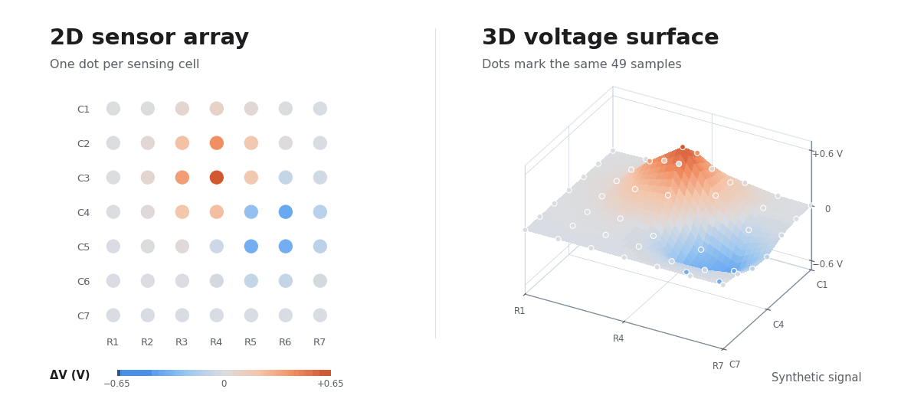

# Tactile Sensor Matrix

An ESP32 scans a 7 × 7 tactile array through two CD74HC4067 multiplexers and a 12-bit AD7276 ADC. The Python host records all 49 cell voltages per frame and replays them as a heatmap and a rotatable 3D surface.



Each dot marks one cell in the same synthetic frame. Blue shows voltage below baseline, silver marks zero, and coral shows voltage above baseline. Surface height shows the same change in volts. [Still image](docs/figures/tactile-maps.png)

## Capture and replay

With the [stable firmware](docs/hardware.md) flashed, run the following from the repository root. Replace the port with your board’s serial device.

```sh
python3 -m venv .venv
source .venv/bin/activate
python -m pip install .
python -m tactile.capture --port /dev/ttyUSB0
```

Keep the array unloaded for the first second to establish the baseline. Close the plot to save the CSV and its standalone HTML replay under `recordings/`. Reopen the latest recording with `python -m tactile.replay`.

## How it works

- **Scan.** Stable mode averages three ADC reads per cell at 921,600 baud. Fast mode takes one read per cell at 1,500,000 baud.
- **Capture.** Each 116-byte packet includes a sequence number, device timestamp and checksum. The host logs valid frames independently of the plot refresh and reports sequence gaps.
- **Map.** Each cell’s resting voltage is subtracted first. Subtracting the frame median then suppresses common-mode shifts. The 2D map shows the grid values directly, and the 3D view uses bilinear interpolation.

[Pinout, flashing and packet layout](docs/hardware.md). To rebuild the [figures](tools/render_maps.py) without hardware, install `.[figures]` and run `python -m tools.render_maps`.
